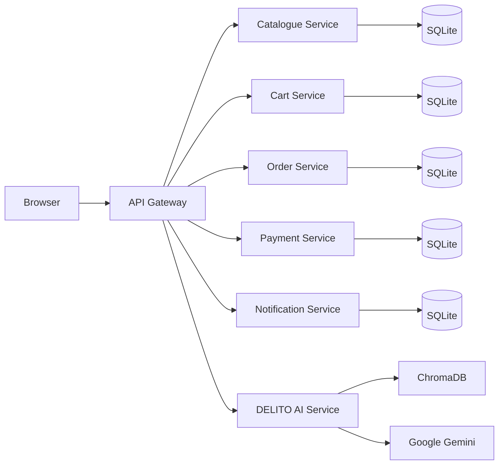

# DELITO

DELITO is a modern grocery quick-commerce application with a React storefront, FastAPI microservices, SQLite databases, and a Gemini-powered RAG grocery assistant.

## Architecture



Each domain service owns a separate SQLite database. The React application only communicates with the versioned API Gateway.

## Local setup

1. Install Docker Desktop and Node.js 20+.
2. Copy `.env.example` to `.env` and set a strong `JWT_SECRET`. Add a rotated `GEMINI_API_KEY` if you want live Gemini generation.
3. Start the complete stack:

   ```powershell
   docker compose up --build
   ```

4. Open `http://localhost:5173`.
5. API documentation: `http://localhost:5173/docs`.

## Deploy to an Ubuntu Azure VM

The Compose stack serves the React app and API through Nginx on port 80. Backend services remain private to the Compose network, and SQLite/image cache data use named Docker volumes.

1. Allow inbound TCP port 80 on the VM's network security group. Keep SSH access restricted to trusted source IPs.
2. SSH to the VM and install Docker Engine and the Compose plugin:

   ```bash
   sudo apt-get update
   sudo apt-get install -y docker.io docker-compose-v2 git openssl
   sudo systemctl enable --now docker
   ```

3. Clone the repository and prepare secrets:

   ```bash
   sudo mkdir -p /opt/delito
   sudo chown "$USER":"$USER" /opt/delito
   git clone https://github.com/anonymoususer-18/Delito-app.git /opt/delito
   cd /opt/delito
   printf 'JWT_SECRET=%s\nGEMINI_API_KEY=\nGEMINI_MODEL=gemini-flash-latest\n' "$(openssl rand -hex 32)" > .env
   chmod 600 .env
   ```

4. Start the app:

   ```bash
   sudo docker compose up -d --build
   ```

5. Visit `http://<VM-public-IP>`. For production use, attach a domain and configure HTTPS before collecting customer data.

To update later, run `git pull --ff-only` and `sudo docker compose up -d --build`. Do not put keys in the repository or deployment command history. Configure a newly rotated Gemini key locally in `/opt/delito/.env`, then recreate the AI service.

## Development

See `docker-compose.yml` for service ports and container configuration.

### Service ports

| Service | Port |
| --- | --- |
| React frontend | 5173 |
| API Gateway | 8000 |
| Catalogue | 8001 |
| Cart | 8002 |
| Order | 8003 |
| Payment | 8004 |
| Notification | 8005 |
| DELITO AI | 8006 |

### Useful API routes

- `POST /api/v1/auth/demo-login`
- `GET /api/v1/catalogue/products`
- `GET /api/v1/catalogue/products/{id}`
- `POST /api/v1/cart`
- `POST /api/v1/orders`
- `GET /api/v1/orders`
- `GET /api/v1/notifications`
- `POST /api/v1/ai/chat`

## GitHub setup

```powershell
git remote add origin https://github.com/anonymoususer-18/Delito-app.git
git switch -c main
git add .
git commit -m "chore: initialize DELITO project"
git push -u origin main
```

Never commit `.env`, API keys, passwords, or SQLite databases.
