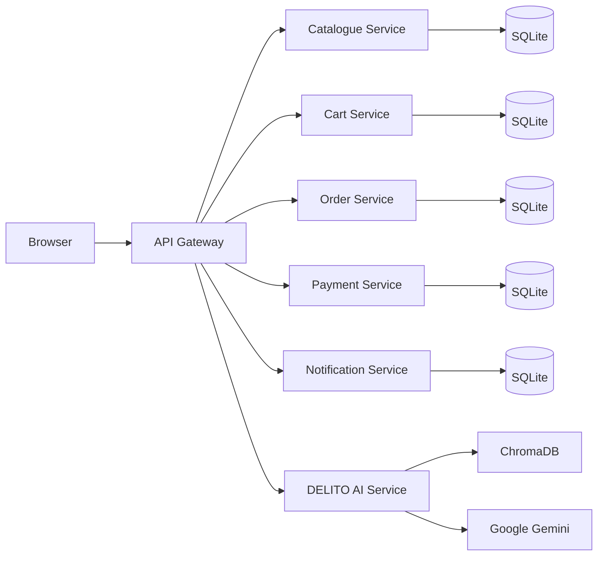

# DELITO

DELITO is a modern grocery quick-commerce application with a React storefront, FastAPI microservices, SQLite databases, and a Gemini-powered RAG grocery assistant.

## Architecture



Each domain service owns a separate SQLite database. The React application only communicates with the versioned API Gateway.

## Local setup

1. Install Docker Desktop and Node.js 20+.
2. Copy `.env.example` to `.env` and set `JWT_SECRET` and `GEMINI_API_KEY`.
3. Start the complete stack:

   ```powershell
   docker compose up --build
   ```

4. Open `http://localhost:5173`.
5. API documentation: `http://localhost:8000/docs`.

## Development

See `docker-compose.yml` for service ports and container configuration.

## GitHub setup

```powershell
git remote add origin https://github.com/anonymoususer-18/Delito-app.git
git switch -c main
git add .
git commit -m "chore: initialize DELITO project"
git push -u origin main
```

Never commit `.env`, API keys, passwords, or SQLite databases.
